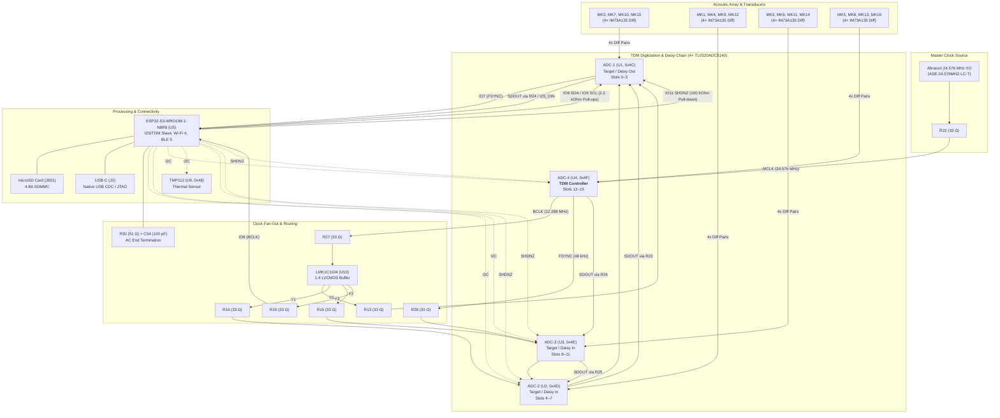

# SSL-16 — 16-Channel Acoustic Sound Source Localization Board (Lab Prototype, Rev A)

The **SSL-16** is a high-precision, downward-tilted acoustic camera board engineered for real-time sound source localization (SSL) and acoustic beamforming, with a primary research target of localizing vehicle horn noise and characterizing traffic acoustic profiles in dense urban environments such as Dhaka, Bangladesh. The hardware integrates **16 Infineon IM73A135 differential analog MEMS microphones** arranged in a non-uniform Vogel (sunflower) spiral layout within an 80 mm radius aperture ($D = 160\,\text{mm}$), digitized synchronously by **four Texas Instruments TLV320ADC5140 4-channel ADCs** over a shared, daisy-chained 16-channel TDM bus into an **Espressif ESP32-S3-WROOM-1-N8R8** dual-core microcontroller with 8 MB Octal PSRAM.

---

## 3D Renders (Rev A)

<p align="center">
  
  
</p>
<p align="center">
  <em>Figure 1: (Left) Top acoustic face with 16 sunflower sound entry ports. (Right) Bottom surface hosting all SMD components, differential routing, and ground flood.</em>
</p>

---

## Key Specifications

| Parameter | Specification / Value | Notes |
|---|---|---|
| **Microphone Array** | 16 × Infineon IM73A135V01XTSA1 (`MK1`–`MK16`) | Analog, differential, bottom-port, 73 dB(A) SNR, 135 dB SPL AOP |
| **Array Geometry** | Vogel / Sunflower spiral ($R = 80\,\text{mm}$ aperture) | Eliminates spatial aliasing up to 6 kHz; bottom-port through 0.8 mm NPTH holes |
| **Audio ADCs** | 4 × TI TLV320ADC5140 (`U1`–`U4`) | 4 differential analog inputs each; QFN-24 with 9 thermal vias per pad |
| **Sample Format** | TDM, 16 slots × 16 bits, $f_s = 48\,\text{kHz}$ | $\text{BCLK} = 12.288\,\text{MHz}$ (256 BCLK cycles per frame) |
| **Master Clock (MCLK)** | 24.576 MHz 3.3V CMOS XO (Abracon ASE-24.576MHZ-LC-T, `Y1`) | Directly feeds `U4` (`GPIO1`); `U4` acts as sole TDM Controller |
| **Clock Fan-Out Buffer** | TI LMK1C1104 (`U10`), 1:4 LVCMOS Buffer | Skew $< 30\,\text{ps}$; buffered BCLK feeds `U1`–`U3` and ESP32 `IO6` via 33 Ω damping resistors |
| **Microcontroller (MCU)**| ESP32-S3-WROOM-1-N8R8 (`U5`) | Dual-core Xtensa LX7 @ 240 MHz, 8 MB Flash, 8 MB Octal PSRAM, native USB-Serial/JTAG |
| **External Storage** | MicroSD socket (Molex 104031-0811, `J601`) | Native 4-bit SDMMC bus (`IO4`, `IO5`, `IO15`, `IO16`, `IO18`, `IO21`) |
| **Power Inputs** | 12 V DC barrel jack (`J8`) or USB-C 5 V (`J2`) | Automatic ideal-diode OR-ing ($Q_1$ P-MOSFET + $D_1$ Schottky) into `VSYS` |
| **Power Regulators** | XL2596S-5.0 (5V buck), AP2112K-3.3 (3V3 digital), TPS7A2033 (3V3A clean analog) | Unified continuous GND plane (no split analog ground) |
| **PCB Dimensions** | 230 mm × 170 mm, 4 layers, 1.6 mm nominal thickness | Stack-up: **JLCPCB JLC04161H-7628**; all 193 SMD components on bottom side |
| **Usable Acoustic Band**| **~1.5 kHz to 6.0 kHz** | Broad mainlobe below 1.5 kHz; zero grating lobes up to 6.0 kHz |

---

## System Architecture



---

## Repository Structure

```
ssl16-acoustic-camera/
├── README.md                           ← Main repository documentation & overview
├── .gitignore                          ← KiCad temporary files and OS artifacts filter
├── .gitattributes                      ← Git LFS configuration for PDFs, images, renders
├── hardware/
│   ├── kicad/                          ← Complete KiCad 10 project source files
│   │   ├── Beamfoarming_16x.kicad_pro  ← KiCad project descriptor
│   │   ├── Beamfoarming_16x.kicad_pcb  ← 4-layer PCB layout (230 × 170 mm)
│   │   ├── Beamfoarming_16x.kicad_sch  ← Hierarchical schematic top sheet
│   │   ├── Beamfoarming_16x.kicad_dru  ← Custom design rule constraints
│   │   ├── Block_diagram.kicad_sch     ← Schematic: System block diagram
│   │   ├── MCU_sch.kicad_sch           ← Schematic: ESP32-S3, power regulators, USB
│   │   ├── adc_1.kicad_sch..adc_4.sch  ← Schematic: TLV320ADC5140 ADC sheets
│   │   ├── tdm.kicad_sch               ← Schematic: Clock buffer & TDM daisy-chain
│   │   ├── sdcard.kicad_sch            ← Schematic: MicroSD socket & activity LED
│   │   ├── MIC_ADC.kicad_sch, etc.     ← Schematic: Microphone coupling sheets
│   │   ├── fp-lib-table, sym-lib-table ← Library tables with portable ${KIPRJMOD} paths
│   │   └── Library_BeamForming/        ← Custom symbols, footprints, and 3D models
│   ├── fabrication/
│   │   └── rev_A/
│   │       ├── gerbers/                ← Exact Gerber & drill files sent to JLCPCB (29-10-2026)
│   │       ├── assembly/               ← JLCPCB BOM (xlsx/csv) and CPL pick-and-place files
│   │       └── README.md               ← Complete JLCPCB fab settings & order notes
│   └── exports/
│       ├── SSL16_RevA_schematic.pdf    ← Full hierarchical schematic export
│       ├── SSL16_RevA_pcb_layers.pdf   ← Individual PCB layer artwork plots
│       ├── drc_report.txt              ← KiCad DRC verification report
│       ├── erc_report.txt              ← KiCad ERC verification report
│       └── renders/                    ← Raytraced 3D renders (top & bottom views)
├── docs/                               ← Comprehensive engineering documentation
│   ├── architecture.md                 ← System architecture & block diagram
│   ├── clocking_and_tdm.md             ← Clock tree, timing margin, and TDM protocol
│   ├── adc_configuration.md            ← TLV320ADC5140 register map & MICBIAS warning
│   ├── microphone_array.md             ← Sunflower array coordinates & acoustic band
│   ├── power.md                        ← Dual-input PDN, ideal diode, and voltage rails
│   ├── pcb_stackup_and_rules.md        ← JLC04161H-7628 stack-up & 50 Ω coplanar rules
│   ├── esp32_pinout.md                 ← Comprehensive GPIO pinout & PSRAM conflict note
│   ├── bringup_checklist.md            ← 8-stage electrical & acoustic bring-up guide
│   ├── known_issues_and_todo.md        ← Rev A observations & Rev B roadmap
│   ├── design_review_log.md            ← Design decision log & engineering changes
│   └── images/                         ← Documentation graphics & diagrams
└── firmware/
    └── README.md                       ← ESP-IDF / Arduino I2S TDM slave driver notes
```

---

## How to Open and Work with the KiCad Project

1. **Software Requirement:** **KiCad 10.0.x** or later.
2. **Opening the Project:**
   - Launch KiCad and open [`hardware/kicad/Beamfoarming_16x.kicad_pro`](file:///h:/My%20Drive/Research_2026/Sound%20Source%20Localizaton/Project/System_Dev/ssl16-acoustic-camera/hardware/kicad/Beamfoarming_16x.kicad_pro).
3. **Library Management:**
   - All custom footprints and schematic symbols are bundled locally inside [`hardware/kicad/Library_BeamForming/`](file:///h:/My%20Drive/Research_2026/Sound%20Source%20Localizaton/Project/System_Dev/ssl16-acoustic-camera/hardware/kicad/Library_BeamForming/).
   - Both `fp-lib-table` and `sym-lib-table` utilize the portable `${KIPRJMOD}` environment variable. The project will open cleanly without broken references or missing libraries on any operating system.

---

## Fabrication & Assembly Summary

- **Manufacturer:** JLCPCB
- **Order Date:** October 2026
- **Stack-Up:** 4 Layers, 1.6 mm thickness, FR-4, **JLC04161H-7628** (outer 1 oz, inner 0.5 oz).
- **Surface Finish:** LeadFree HASL / ENIG; 0.2 mm plugged vias.
- **SMT Placements:** 193 placements (Bottom side only).
- **Production Files:**
  - Complete Gerbers: [`hardware/fabrication/rev_A/gerbers/`](file:///h:/My%20Drive/Research_2026/Sound%20Source%20Localizaton/Project/System_Dev/ssl16-acoustic-camera/hardware/fabrication/rev_A/gerbers/)
  - BOM & CPL: [`hardware/fabrication/rev_A/assembly/`](file:///h:/My%20Drive/Research_2026/Sound%20Source%20Localizaton/Project/System_Dev/ssl16-acoustic-camera/hardware/fabrication/rev_A/assembly/)
  - Order parameters & alignment remarks: [`hardware/fabrication/rev_A/README.md`](file:///h:/My%20Drive/Research_2026/Sound%20Source%20Localizaton/Project/System_Dev/ssl16-acoustic-camera/hardware/fabrication/rev_A/README.md)

---

## Documentation Index

Detailed engineering documentation is organized inside [`docs/`](file:///h:/My%20Drive/Research_2026/Sound%20Source%20Localizaton/Project/System_Dev/ssl16-acoustic-camera/docs/):

1. [**System Architecture & Block Diagram**](docs/architecture.md): High-level system structure, TDM controller concept, and clock distribution.
2. [**Clocking & TDM Bus Architecture**](docs/clocking_and_tdm.md): Master clock tree, 12.288 MHz distribution, timing margins, and transmission line damping.
3. [**ADC Configuration & Register Map**](docs/adc_configuration.md): TLV320ADC5140 initialization scripts, daisy-chain timing, and MICBIAS safety limits.
4. [**Sunflower Microphone Array**](docs/microphone_array.md): Vogel spiral geometry, exact coordinates (mm), acoustic bandwidth (1.5–6 kHz), and port keep-outs.
5. [**Power Delivery Network (PDN)**](docs/power.md): Dual-input 12V/USB power architecture, ideal-diode OR-ing, LDO regulation, and unified ground plane.
6. [**PCB Stack-Up & Design Rules**](docs/pcb_stackup_and_rules.md): JLC04161H-7628 layer stack, 50 Ω coplanar waveguides, differential pair rules, and keep-outs.
7. [**ESP32-S3 Pinout & Interface Mapping**](docs/esp32_pinout.md): Complete MCU pinout table, peripheral assignments, and Octal PSRAM GPIO35–37 advisory.
8. [**Hardware Bring-Up Checklist**](docs/bringup_checklist.md): 8-stage electrical verification procedure from cold checks to beamforming tests.
9. [**Known Issues & Rev B Roadmap**](docs/known_issues_and_todo.md): Identified prototype errata, BOM substitutions, and optimizations for Revision B.
10. [**Hardware Design Review Log**](docs/design_review_log.md): Record of design modifications and engineering decisions resolved during development.
11. [**Firmware Notes**](firmware/README.md): ESP-IDF and Arduino driver implementation notes and DMA configuration.

---

## Project Status

**Current Status:** **Rev A ordered from JLCPCB (Oct 2026), bring-up pending.**

---

## Authors & Affiliation

**Designers:**  
- **MD Abdus Shakur Siam** ([@shakursiam](https://github.com/shakursiam))  
- **Sadaf Shafin**  
- **Ashir Intesher**  

**Research Laboratory:**  
**HIVE (Hydrogen, Intelligent Vehicles & Energy) Research Group**  
Department of Electrical and Electronic Engineering (EEE)  
**Bangladesh University of Engineering and Technology (BUET)**, Dhaka, Bangladesh  

---

## Intellectual Property Notice

*All rights reserved – contact the authors for academic or commercial use. This repository contains unpublished research hardware.*
