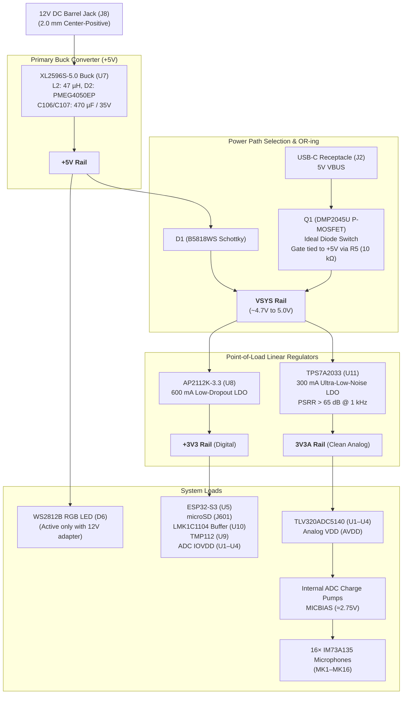

# SSL-16 Power Delivery Network (PDN) Architecture

## 1. Power Distribution Overview

The SSL-16 board features a dual-source power architecture capable of operating from either an external **12 V DC power supply** (barrel jack `J8`) or direct **5 V USB-C power** (`J2`).

---

## 2. Voltage Rails & Domain Specifications

| Rail Name | Nominal Voltage | Source IC / Circuit | Connected Loads | Current Capacity | Design Considerations |
|---|---|---|---|---|---|
| **+12V** | 12.0 V DC | Barrel Jack `J8` | XL2596S-5.0 Input | 2.0 A max | Input diode protection and bulk 470 µF decoupling |
| **+5V** | 5.0 V | XL2596S-5.0 (`U7`) | D1 (→ VSYS), WS2812B (`D6`) | 3.0 A max | Switcher ripple attenuated by large LC filter ($L_2=47\,\mu\text{H}$, $C_{107}=470\,\mu\text{F}$) |
| **VBUS** | 5.0 V | USB-C (`J2`) | Q1 Source | 1.5 A max | $5.1\,\text{k}\Omega$ pulldowns on CC1/CC2 pins |
| **VSYS** | 4.6–5.0 V | Q1 / D1 OR-ing node | Inputs of LDOs `U8` and `U11` | 2.0 A max | System power backbone under both USB and adapter operation |
| **+3V3** | 3.3 V | AP2112K-3.3 (`U8`) | ESP32-S3, SD card, LMK buffer, TMP112, ADC IOVDD | 600 mA | High-speed digital switching rail; decoupled locally with 0402 ceramics |
| **3V3A** | 3.3 V | TPS7A2033 (`U11`) | TLV320ADC5140 AVDD pins (`U1`–`U4`) | 300 mA | Ultra-low noise ($12\,\mu\text{V}_{\text{RMS}}$), high PSRR; filtered via ferrite bead `FB1` |
| **MICBIAS** | ~2.75 V | Internal ADC VREF | 16× IM73A135 VDD inputs | ~10 mA per ADC | Derived from clean internal bandgap; decoupled with local $1\,\mu\text{F}$ per mic |

---

## 3. Power-Path Switching & Automatic OR-ing

The SSL-16 features seamless automatic power switching between the 12 V DC wall adapter and 5 V USB-C without causing MCU resets:

1. **USB-Only Operation:**
   - When only USB-C is connected, the `+5V` rail is inactive ($0\,\text{V}$).
   - Pull-down resistor $R_5$ ($10\,\text{k}\Omega$) pulls the gate of P-MOSFET $Q_1$ (DMP2045U) to ground, turning $Q_1$ fully **ON** with an ultra-low $R_{\text{DS(on)}} \approx 30\,\text{m}\Omega$.
   - VBUS feeds directly into `VSYS` with $< 30\,\text{mV}$ dropout. Diode $D_1$ blocks back-feeding into the buck converter.
   - The board operates fully (MCU, SD card, ADCs, microphones, capture) **except the WS2812B LED `D6`**, which is intentionally unpowered on USB power.
2. **12 V Adapter Operation:**
   - The XL2596S generates `+5V`.
   - `+5V` passes through Schottky diode $D_1$ (B5818WS, forward drop $\sim 0.35\,\text{V}$) to supply `VSYS` at $\sim 4.65\,\text{V}$.
   - Simultaneously, `+5V` applies directly to the gate of $Q_1$. Since $V_{\text{GS}} \ge 0\,\text{V}$, $Q_1$ is driven hard **OFF**, isolating the USB VBUS line from the adapter supply.
3. **Simultaneous USB & Adapter Connection:**
   - The adapter takes precedence. $Q_1$ turns off, preventing reverse current from driving into host USB ports.

---

## 4. Grounding Philosophy: Unified Ground (GND)

> [!IMPORTANT]  
> **Single Ground Strategy:**  
> The SSL-16 uses a **single continuous Ground plane (GND)** across the entire PCB. There is **NO split analog ground (AGND)**.  
> 
> *Design Rationale:* Partitioning ground planes creates inductive loop antennas across the split when digital clock lines (BCLK, FSYNC, I2S_DIN) traverse the gap. High analog SNR is instead maintained by:
> - Physical layout separation (acoustic array in left/center, digital MCU in top-right, power buck in bottom-right).
> - Dedicated ultra-low-noise analog LDO (`U11` TPS7A2033) for ADC AVDD.
> - Solid continuous reference plane on Layer 3 (`In2.Cu`) directly beneath high-speed digital tracks.
