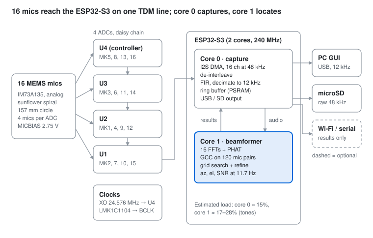

# SSL-16: System Architecture and Computational Budget

> How the SSL-16 microphone-array board is built, how much data it produces, and whether its ESP32-S3
> microcontroller can locate a sound source on its own, without a PC.

**Board:** SSL-16 Rev A · **Author:** MD Abdus Shakur Siam, HIVE Research Group, BUET · **Last updated:** 15 Nov 2026

---

## Contents

1. [Summary: the key questions answered](#1-summary-the-key-questions-answered)
2. [What SSL-16 is](#2-what-ssl-16-is)
3. [System architecture](#3-system-architecture)
4. [Signal chain and data rates](#4-signal-chain-and-data-rates)
5. [Sampling rate: limits and needs](#5-sampling-rate-limits-and-needs)
6. [Array physics: what the array can and cannot resolve](#6-array-physics-what-the-array-can-and-cannot-resolve)
7. [The beamforming algorithm and its cost](#7-the-beamforming-algorithm-and-its-cost)
8. [Compute budget on the ESP32-S3](#8-compute-budget-on-the-esp32-s3)
9. [Search-grid size](#9-search-grid-size)
10. [Memory budget](#10-memory-budget)
11. [Using both CPU cores](#11-using-both-cpu-cores)
12. [Limitations and open measurements](#12-limitations-and-open-measurements)
13. [Glossary](#13-glossary)
14. [References](#14-references)

---

## 1. Summary: the key questions answered

| Question | Short answer | Details |
| --- | --- | --- |
| **Can the ESP32-S3 microcontroller on the board compute the direction of a sound by itself, without sending audio to a PC?** | Yes, but only with a reformulated algorithm. The method used in our PC software would need about 6× the power of one CPU core. Rewritten as pairwise GCC-PHAT with a lookup table, the same result costs about 28% of one core for 11.7 direction updates per second. | [§7](#7-the-beamforming-algorithm-and-its-cost), [§8](#8-compute-budget-on-the-esp32-s3) |
| **How many candidate directions can the board test in each update, and how fine can the angle steps be?** | About 5,600 directions (2° steps in azimuth × 3° in elevation) at 11.7 updates per second. A full 1° × 1° hemisphere (32,760 directions) only reaches about 8–9 updates per second. Recommended: a coarse 5° × 5° search followed by a local 0.5° refinement, which costs about 17% of a core and gives 0.5° final steps. | [§9](#9-search-grid-size) |
| **What is the highest audio sampling rate the board can record at?** | 48 kHz on all 16 channels at 16-bit resolution, verified on the first assembled board. 96 kHz, or 24/32-bit samples, are not possible with this board's wiring, because the ESP32-S3's audio input cannot run its clock that fast. | [§5](#5-sampling-rate-limits-and-needs) |
| **What sampling rate does sound localization actually need?** | 12–16 kHz is enough. The array can only resolve direction for sounds between about 1.5 and 6 kHz, and a lower sampling rate does not reduce angular accuracy. | [§5](#5-sampling-rate-limits-and-needs), [§6](#6-array-physics-what-the-array-can-and-cannot-resolve) |
| **Can all 16 raw audio channels be streamed to a PC over USB?** | Not at 48 kHz: 1.54 MB/s is more than the board's full-speed USB port can carry. After reducing the rate on the board, 12 kHz (0.38 MB/s) fits comfortably; 24 kHz (0.77 MB/s) is close to the practical limit and should be verified for each setup. | [§4](#4-signal-chain-and-data-rates) |
| **How often does the board report a direction, and how far behind real time is it?** | One estimate every 85 ms (11.7 per second). Each result describes sound from roughly 0.1–0.2 s earlier. | [§8](#8-compute-budget-on-the-esp32-s3) |
| **How are the ESP32-S3's two CPU cores used?** | For on-board localization, core 0 handles the time-critical audio capture, filtering and output, and core 1 runs the direction finding. A simpler streaming-only firmware can run everything on one core. | [§11](#11-using-both-cpu-cores) |

> **How reliable are these numbers?** The array geometry and data rates are exact. The 48 kHz capture has been
> measured on hardware. All ESP32-S3 processing times are **estimates**, built from cycle counts that Espressif
> publishes for its DSP library plus stated assumptions. They must be confirmed by profiling on the board
> ([§12](#12-limitations-and-open-measurements)).

---

## 2. What SSL-16 is

SSL-16 is a 16-microphone array on a single PCB for **sound source localization (SSL)**: estimating the direction a sound comes from. The target application is locating vehicle horns in dense city traffic (Dhaka, Bangladesh), but the board works for any source between about 1.5 and 6 kHz: buzzers, alarms, whistles, voices.

| Part | Choice |
| --- | --- |
| Microphones | 16 × Infineon IM73A135 analog MEMS microphones, arranged in a sunflower (Vogel) spiral inside a 157 mm circle |
| Analog-to-digital converters | 4 × Texas Instruments TLV320ADC5140, 4 channels each |
| Processor | Espressif ESP32-S3 (dual-core, 240 MHz, 8 MB external PSRAM, native USB) |
| Storage | microSD card slot |
| Power | 12 V adapter or USB-C |

The microphones point through holes in the board, so the board's face is the "listening" side.

---

## 3. System architecture

Sixteen analog microphones feed four ADCs. The ADCs are chained so that all 16 channels reach the ESP32-S3 over a single digital audio line. Inside the ESP32-S3, the on-board localization firmware splits the work: core 0 keeps the audio flowing, core 1 turns it into a direction.



**Clocking.** ADC U4 is the clock master. It takes a 24.576 MHz crystal oscillator and generates the bit clock (12.288 MHz) and the frame sync (48 kHz). A TI LMK1C1104 clock buffer copies the bit clock to the other three ADCs and to the ESP32-S3, so every channel is sampled at the same instant. Simultaneous sampling is essential, because direction is computed from tiny time differences between microphones.

**Two ways to run the board.** In *streaming mode*, the ESP32-S3 sends filtered audio to a PC, and the direction is computed there (Python software in `software/python/`). In *on-board mode*, the beamformer on core 1 (highlighted) computes the direction on the board itself, and only the result is sent out. This document describes both and gives the budget for the on-board mode.

---

## 4. Signal chain and data rates

The board produces 1.536 MB/s of raw audio, all arriving at the ESP32-S3 on one wire. Everything after that point is about reducing this stream to something a link can carry or a processor can handle.

| Stage | What happens | Data rate |
| --- | --- | --- |
| Microphones | 16 analog MEMS mics with differential outputs, powered at about 2.75 V by the ADCs (MICBIAS) | 16 analog signals |
| ADCs | 4 converters × 4 channels, 16-bit samples at 48 kHz | 16 × 48,000 × 16 bit |
| Clocks | Bit clock = 16 slots × 16 bit × 48 kHz | 12.288 MHz |
| TDM daisy chain | ADC U4 → U3 → U2 → U1 → ESP32-S3 pin IO13; each ADC adds its 4 channels to the frame | 12.288 Mbit/s = **1.536 MB/s** on one line |
| ESP32-S3 audio input (I2S, target mode) | DMA writes the stream into RAM in 2.6 ms chunks (127 frames × 32 bytes) | 1.536 MB/s into memory |
| Anti-alias filter + decimation | Low-pass filter, then keep every 4th (or 2nd) sample | 12 kHz: **0.384 MB/s**; 24 kHz: 0.768 MB/s |
| USB to a PC (full speed, 12 Mbit/s signalling) | Data packets read by the PC software | 12 kHz fits with margin; raw 48 kHz cannot fit |
| microSD card (4-bit SD mode) | Recording without a PC attached | Bus up to about 10 MB/s; real write speed depends on the card (`firmware/arduino/SSL16_SDTest` measures it) |
| On-board localization result | Azimuth, elevation and signal-to-noise ratio per update | About 20 bytes × 11.7 per second: negligible |

The last row is the main argument for processing on the board. The raw audio needs about 1.5 MB/s; the result needs a few hundred bytes per second. A field unit could therefore report over Wi-Fi, LoRa or a plain serial link, with no PC attached.

---

## 5. Sampling rate: limits and needs

The hardware can record at 48 kHz at most, and the localization algorithm needs only 12–16 kHz. The limit comes from the ESP32-S3's audio input (I2S), not from the ADCs.

### Why 48 kHz is the ceiling

All 16 channels share one TDM line, so the bit clock grows with the sampling rate:

```
f_BCLK = N_slots × W_slot × f_s = 16 × 16 bit × 48 kHz = 12.288 MHz
```

When the ESP32-S3 receives a clock from outside (target or "slave" mode), its driver needs an internal clock of at least 8 × the bit clock (`bclk_div ≥ 8`). That internal clock is derived from a 160 MHz PLL ([ESP-IDF I2S documentation](https://docs.espressif.com/projects/esp-idf/en/v5.4.3/esp32s3/api-reference/peripherals/i2s.html)).

| Recording setting | Bit clock | Internal clock needed (× 8) | Possible? |
| --- | --- | --- | --- |
| 16 channels × 16 bit, 24 kHz | 6.144 MHz | 49 MHz | Yes |
| **16 channels × 16 bit, 48 kHz** | **12.288 MHz** | **98 MHz** | **Yes, verified on hardware** |
| 16 channels × 16 bit, 96 kHz | 24.576 MHz | 197 MHz | No: above the 160 MHz source |
| 16 channels × 32 bit, 48 kHz | 24.576 MHz | 197 MHz | No, for the same reason |

### A documented limit the board appears to exceed

The ESP-IDF documentation states that, "due to the hardware limitation", the ESP32-S3 supports only 8 TDM slots at 16-bit width. The first SSL-16 board nevertheless delivers 16 slots with clearly different signal levels (for example −58 dBFS in slot 7 and −86 dBFS in slot 15 in the same frame), so the data are not simply 8 slots repeated.

The final proof is a **tap test**: scratch next to one microphone at a time and confirm that only its own slot responds. If slots 8–15 failed that test, the options would be 8-bit slots (too coarse to be useful) or a second I2S input, which needs a hardware change.

### Why 12–16 kHz is enough

- The useful frequency band is about 1.5–6 kHz ([§6](#6-array-physics-what-the-array-can-and-cannot-resolve)). By the Nyquist criterion, sampling at 12 kHz captures everything up to 6 kHz, and 16 kHz up to 8 kHz.
- Direction is computed from time differences between microphones, at most 419 µs across this array. That is 20 samples at 48 kHz but only 5 at 12 kHz. The algorithm works on phase in the frequency domain, so it resolves delays far smaller than one sample. A lower sampling rate does not reduce angular accuracy, as long as the frequencies of interest are captured.
- Car horns have their fundamental tone near 400–500 Hz, below the range where this small array can resolve direction. Their higher harmonics are used for localization instead.

### Recommended rates

- **Record at 48 kHz**, so the ADCs' built-in anti-alias filters work as designed.
- **Reduce to 12 kHz on the ESP32-S3** for buzzers, alarms and horns, or to 16 kHz if sources up to 8 kHz matter.
- **Keep 48 kHz** only for raw recordings to the SD card that are meant for offline research.

---

## 6. Array physics: what the array can and cannot resolve

The size of the array, not the electronics, sets what it can resolve. With microphones at most 143.6 mm apart, each "beam" is wide (about 49° at 2.8 kHz). A single source can still be located to about 1°, because the peak of a wide beam can be found precisely when the signal is clean.

**Geometry** (from the microphone coordinate table): 16 microphones inside a 157 mm circle; 120 microphone pairs; largest pair spacing D = 143.6 mm; smallest 27.2 mm. Speed of sound c = 343 m/s at 20 °C.

```
Maximum time difference:   τ_max = D / c = 0.1436 m / 343 m/s = 419 µs
Beam width (approximate):  θ_beam ≈ λ / D
Far-field distance:        r_ff = 2 D² / λ
```

| Frequency | Wavelength λ | Beam width ≈ λ/D | Far field starts at r_ff | Comment |
| --- | --- | --- | --- | --- |
| 1.0 kHz | 34.3 cm | 137° | 0.12 m | Almost no directivity |
| 1.5 kHz | 22.9 cm | 91° | 0.18 m | Lower edge of the useful band |
| 2.8 kHz | 12.2 cm | 49° | 0.34 m | Typical buzzer |
| 4.0 kHz | 8.6 cm | 34° | 0.48 m | |
| 5.0 kHz | 6.9 cm | 27° | 0.60 m | |
| 6.0 kHz | 5.7 cm | 23° | 0.72 m | Upper edge of the useful band |

What this means in practice:

- **Accuracy is not the same as resolution.** *Accuracy* (where a single source is) is about 1° in simulation at good signal-to-noise ratio. *Resolution* (separating two sources) is about one beam width: two buzzers of the same frequency closer than about 40–50° merge into one peak. Sources at different frequencies can be separated by frequency instead.
- **Upper band edge.** Above about 6.3 kHz, the two closest microphones (27.2 mm) are more than half a wavelength apart, so the phase becomes ambiguous. The irregular spiral layout turns this into a raised background of false responses rather than clean "ghost" peaks, but the useful band still ends near 6 kHz.
- **Lower band edge.** Below about 1.5 kHz the beam covers most of the hemisphere. Horn fundamentals (400–500 Hz) can be *detected* but not *localized*.
- **Far field.** The algorithm assumes the sound arrives as a flat (plane) wave. Beyond about 0.7 m this holds over the whole band; closer sources need a near-field model.
- **Elevation.** A flat array senses elevation only through cos(elevation), which changes slowly near the board's plane. Elevation errors therefore grow when the source is nearly level with the board (10–12° in simulation at 10° elevation), while azimuth stays accurate.
- **Front or back.** A flat array cannot tell whether a sound comes from in front of the board or behind it.

---

## 7. The beamforming algorithm and its cost

The same direction map can be computed in two ways. The direct form, used in our PC software, would cost about 6 ESP32-S3 cores. The pairwise form gives the same map for about a quarter of one core, so it is the one to run on the board.

### What SRP-PHAT computes

SRP-PHAT (Steered Response Power with PHAse Transform) is a standard, robust localization method. For each candidate direction **u**:

1. delay each microphone's signal by the time the sound would need to reach it from that direction (τ_m(**u**));
2. add the 16 delayed signals;
3. measure the power of the sum.

The direction with the most power wins. The PHAT step divides each frequency component by its own magnitude, keeping only phase. This sharpens the peak and makes the method robust to the source's spectrum and to room echoes.

```
P(u) = Σ_k | Σ_{m=1..16}  X_m(f_k) / |X_m(f_k)| · exp( j·2π·f_k·τ_m(u) ) |²
```

where X_m(f_k) is microphone m's spectrum at frequency bin k.

### Form 1: direct (used in the PC software)

For every direction, every frequency bin and every microphone, compute one complex exponential and one multiply-add. With 5,580 directions × 24 bins × 16 microphones, that is 2.1 million terms per update. Each term needs a sine and a cosine, so the cost is roughly 130 million CPU cycles per update: about **6.3 ESP32-S3 cores** at 11.7 updates per second. Precomputing all the exponentials would need about 17 MB, more than the board's 8 MB PSRAM.

### Form 2: pairwise GCC-PHAT with a lookup table (for on-board use)

Expanding the square splits P(**u**) into a sum over the 120 microphone pairs. Each pair's term depends on the direction only through that pair's time difference:

```
P(u) = const + 2 · Σ_{pairs i<j} R_ij( τ_i(u) − τ_j(u) )

R_ij(τ) = Σ_k Re{ X_i·X_j* / (|X_i|·|X_j|) · exp( j·2π·f_k·τ ) }      (GCC-PHAT of pair i, j)
```

Each update then needs three cheap steps:

1. **Cross-correlate each pair (GCC):** evaluate R_ij on a fixed grid of time differences, −419 to +419 µs in 5 µs steps (169 values). Cost: 120 pairs × 169 delays × K frequency bins × 2 multiply-adds.
2. **Look up and add:** a precomputed table stores, for every direction, which delay value each of the 120 pairs sees (1 byte per pair). The power of a direction is the sum of 120 table lookups.
3. **Find the peak and refine:** take the best direction of the coarse grid, then refine around it in 0.5° steps, interpolating between delay values.

The result is the same map, apart from rounding to the 5 µs delay grid. That rounding moves the longest pair's angle by at most about 0.35°; averaging over 120 pairs and interpolation reduce it further.

### How many frequency bins (K)?

- **Tones** (buzzers, horn harmonics): K = 16–32 of the strongest bins between 1.5 and 5 kHz, keeping only bins within 20 dB of the strongest. This is cheap.
- **Short broadband sounds** (claps, snaps, the start of a horn): K ≈ 128 bins across the band. Step 1 then costs about 4× more.

---

## 8. Compute budget on the ESP32-S3

The whole pipeline (capture, filtering, FFT, GCC and a 5,580-direction search) needs about 102 million CPU cycles per second, out of 480 million available on the two cores: roughly **15% of core 0 and 28% of core 1**. Each update takes about 24 ms of computing against an 85 ms deadline.

### Inputs

Cycle counts measured by Espressif for the ESP32-S3 with its optimized DSP library, esp-dsp ([benchmarks](https://docs.espressif.com/projects/esp-dsp/en/latest/esp-dsp-benchmarks.html)):

| esp-dsp function | Size | Cycles on ESP32-S3 | Used here for |
| --- | --- | --- | --- |
| `dsps_fft4r_fc32` | 1,024 complex points | 64,482 | 2,048-point real FFT (plus about 12,000 cycles of real-FFT post-processing, estimated) |
| `dsps_fft2r_sc16` | 1,024 complex points | 15,623 | Fixed-point alternative, about 4× faster |
| `dsps_fird_f32` | 1,024 inputs, 256 taps, decimate by 4 | 115,499 | Gives 1.76 cycles per tap per output sample |
| `dsps_dotprod_f32` | 256 | 432 | Gives about 1.7 cycles per multiply-add |

**Further assumptions:** both cores at 240 MHz; one table lookup plus addition from PSRAM costs about 5 cycles; splitting the interleaved audio into channels costs about 3 cycles per sample.

### Budget per second

Configuration: 12 kHz, 2,048-sample window, a new update every 1,024 samples (11.7 per second), K = 16 bins, 5,580 directions.

| Stage | Core | Million cycles / s | Share of one core |
| --- | --- | --- | --- |
| Split the 16 × 48 kHz stream into channels, convert to float | 0 | 2.3 | 1% |
| Anti-alias filter (96 taps) and decimation 48 → 12 kHz with esp-dsp | 0 | 32.4 | 13.5% |
| 16 FFTs of 2,048 points | 1 | 14.3 | 6% |
| PHAT whitening and cross-spectra (120 pairs × 16 bins) | 1 | < 1 | < 0.5% |
| GCC on 169 delays × 120 pairs × 16 bins | 1 | 12.9 | 5.4% |
| Direction search: 5,580 directions × 120 lookups | 1 | 39.3 | 16.4% |
| **Total** | | **≈ 102** | **core 0 ≈ 15%, core 1 ≈ 28%** |

USB or SD output adds a few percent on core 0. Wi-Fi would add more and is not included.

**Plain C vs optimized library.** The streaming sketches (`firmware/arduino/SSL16_Stream`, `firmware/arduino/SSL16_HDOA`) run the anti-alias filter as a plain C loop, estimated at 4–6 cycles per tap. That is about 38% of one core at 12 kHz output and 46% at 24 kHz, all on one core. Switching to `dsps_fird_f32` should cut this by about 3×. Both figures should be confirmed with `esp_cpu_get_cycle_count()`.

**Latency.** Each analysis window covers 171 ms of audio, and a new result appears every 85 ms. With about 24 ms of computing per update, each result describes sound from roughly 0.1–0.2 s earlier. That is ample for horn detection. For tracking fast-moving sources, use a shorter window: 1,024 samples halves the latency but makes the frequency bins twice as wide.

---

## 9. Search-grid size

The recommended search is a coarse 5° × 5° grid followed by a local 0.5° refinement. It costs about 17% of a core and gives finer final steps than any fixed grid that fits. The cost grows linearly with the number of directions, because each direction is 120 table lookups.

| Grid | Directions | Lookup table size (120 bytes per direction) | Core-1 load at 11.7 updates/s, tones (K = 16) | Max updates/s, tones | Core-1 load at 11.7 updates/s, claps (K = 128) | Max updates/s, claps |
| --- | --- | --- | --- | --- | --- | --- |
| Horizontal bearing only, 1° steps (board upright, source at board height) | 181 | 21 KB | 12% | 78 | 51% | 18 |
| Azimuth 5° × elevation 5° | 1,368 | 160 KB | 16% | 61 | 54% | 17 |
| **5° × 5°, then 0.5° refinement around the peak** | **1,368 + 441** | **212 KB** | **17%** | **56** | **55%** | **17** |
| Azimuth 2° × elevation 3° (same as the PC software) | 5,580 | 654 KB | 28% | 34 | 67% | 14 |
| Azimuth 1° × elevation 1° (full hemisphere) | 32,760 | 3.8 MB | 108% (does not fit) | 8.7 | 146% (does not fit) | 6.4 |

"Max updates/s" assumes core 1 may be 80% busy. Rates above 11.7 per second only matter if the window is advanced more often; here they show the spare capacity.

How to read the table:

- **The grid step is not the final accuracy.** The final angle comes from the refined peak, so a coarse grid plus refinement is as precise as a fine grid. The coarse grid only has to be fine enough not to miss the main beam, which is at least 23° wide below 6 kHz. 5° steps are safe.
- **Claps cost more because of K, not the grid.** Broadband sounds need about 128 frequency bins, so the GCC step dominates. Claps are short and rare, though, and need processing only when a sudden-sound detector fires.
- **The 1° × 1° grid** runs at about 8–9 updates per second using most of a core, and its 3.8 MB table must be read from PSRAM on every update (about 33 MB/s). It is possible, but it gains nothing over coarse-to-fine.

---

## 10. Memory budget

On-board localization needs about 260 KB of fast internal RAM and under 1 MB of external PSRAM. Both fit, but internal RAM is the tighter of the two. Rule of thumb: anything read in random order, or written by DMA, goes in internal SRAM; large tables read in order go in PSRAM.

The ESP32-S3 module has 512 KB of internal SRAM (part of it used by the system, and by Wi-Fi when enabled) and 8 MB of octal PSRAM (confirmed on hardware: 8,388,608 bytes).

| Buffer | Size | Location | Reason |
| --- | --- | --- | --- |
| I2S DMA buffers | 24 × 4,064 B ≈ 95 KB (63 ms of audio) | Internal (DMA-capable) | 8 buffers (≈ 32 KB) give only 21 ms of slack (see below) |
| Filter history + input block, 16 channels, 96 taps | ≈ 37 KB | Internal | Inner loop of the filter |
| Decimated ring buffer, 1 s at 12 kHz | 384 KB | PSRAM | Hand-over between the two cores; written and read in order |
| FFT work buffer (one channel at a time) | 16 KB | Internal | FFT speed |
| Spectra of the useful band, 16 channels × ≈ 600 bins | ≈ 77 KB | PSRAM or internal | Only the 1.5–5 kHz bins are kept |
| GCC results, 120 pairs × 169 delays (float) | 81 KB | Internal | Read in random order during the search |
| Direction lookup table, 5° × 5° + refinement | 212 KB (654 KB for 2° × 3°) | PSRAM | Read in order, once per update |
| Raw 48 kHz recording to SD | 1.536 MB per second of audio | PSRAM buffer → SD | Absorbs pauses in SD writes |

### The most fragile point: I2S DMA slack

ESP-IDF limits each DMA buffer to 4,092 bytes. With 32 bytes per frame (16 channels × 2 bytes), each buffer holds at most 127 frames, which is 2.6 ms at 48 kHz. The streaming sketches request 480 frames per buffer; the boot log shows what the driver actually applied. With 8 buffers, the firmware must collect the audio at least every 21 ms, or samples are lost. Heavy processing in the same loop as the audio capture (filtering, beamforming) puts this at risk.

**Fix:** raise `dma_desc_num` to about 24 (63 ms of slack) and move processing to the other core.

---

## 11. Using both CPU cores

Two firmware designs are possible. The single-loop design is simple and enough for streaming audio to a PC. The dual-core design is needed for on-board localization: it puts the time-critical audio capture on core 0 and the heavy direction finding on core 1, so a slow computation can never cost audio samples.

### Single-loop design (streaming firmware)

In the streaming sketches (`SSL16_Stream`, `SSL16_HDOA`, `SSL16_SelfTest`), Arduino runs `setup()` and `loop()` as one FreeRTOS task on core 1. Each pass of the loop:

1. waits for 10 ms of audio from I2S;
2. splits it into channels;
3. filters and decimates it (estimated 38–46% of the core);
4. builds data packets;
5. writes them to USB.

Core 0 runs only system tasks (and Wi-Fi, if enabled), so it is almost idle. The DMA engine fills the audio buffers without the CPU, so the capture itself is nearly free; the risk is the loop coming back too late.

### Dual-core design (on-board localization)

FreeRTOS tasks pinned to a core with `xTaskCreatePinnedToCore`:

| Core | Task | Priority | Work | Expected load |
| --- | --- | --- | --- | --- |
| 0 | Acquisition | Highest of the application | Read I2S every 10 ms; split channels; filter + decimate with esp-dsp; write 12 kHz blocks into a ring buffer; optionally copy raw 48 kHz audio to the SD buffer | ≈ 15% |
| 0 | Output | Low | USB packets (raw 12 kHz audio and/or results), SD writes, commands (START / STOP / STATUS) | a few % |
| 1 | Beamformer | Medium | Wait for 1,024 new samples → 16 FFTs → bin selection + PHAT → GCC → coarse search → refinement → detection → send {azimuth, elevation, SNR, time} to the output task | ≈ 17–28% for tones; ≈ 55–67% for claps |
| 1 | Arduino loop | Low | Idle / housekeeping | — |

Design rules that keep it safe:

- **Capture never waits for the beamformer.** The only link between the cores is the ring buffer (a FreeRTOS ring buffer or stream buffer). If the beamformer falls behind, it skips a block and counts the skip; the audio stays intact.
- **Enough DMA slack.** 24 DMA buffers (63 ms), so even a long USB or SD stall on core 0 does not lose samples.
- **Wi-Fi changes the picture.** The Wi-Fi stack runs at high priority on core 0. If a field unit uses Wi-Fi, move acquisition to core 1 with the highest priority there, run the beamformer at a lower priority, and keep the DMA slack large.
- **Measure, don't trust estimates.** Log `esp_cpu_get_cycle_count()` for each stage, the ring-buffer fill level, and the I2S overflow counter (reported by `SSL16_HDOA`'s `STATUS` command).

---

## 12. Limitations and open measurements

The hard limits come from physics and from the ESP32-S3's audio input. The compute figures are estimates with comfortable margins; the measurements below confirm them on a given board and firmware.

### Hard limits (these need new hardware to change)

| Limit | Value | Consequence |
| --- | --- | --- |
| Recording rate | 48 kHz × 16 channels × 16 bit at most | No 96 kHz, no 24/32-bit samples with this wiring |
| Useful frequency band | ≈ 1.5–6 kHz | Horn fundamentals cannot be localized, only their harmonics |
| Angular resolution | Beam width 23–91° across the band | Two same-frequency sources closer than about 40–50° merge |
| Elevation near the board's plane | Weak (10–12° error at 10° elevation, simulated) | Mount the array so that sources are well off its plane |
| Front / back | Cannot be told apart (flat array) | Mount against a wall or in a housing, or tilt the board |
| Far field | Model valid beyond about 0.7 m | Closer sources need a near-field model |
| USB full speed | Raw 48 kHz audio cannot be streamed | Decimate, record to SD, or process on the board |
| Documented 8-slot TDM limit at 16 bit | The board appears to exceed it | Confirmed only once the tap test passes |

### Validation measurements

- [ ] **Tap test:** each of the 16 slots responds only to its own microphone (confirms 16-slot TDM capture)
- [ ] **Boot log:** actual DMA frames per buffer; I2S overflow count during a 10-minute run
- [ ] **CPU cycles per stage** with `esp_cpu_get_cycle_count()`: plain-C filter vs `dsps_fird_f32`
- [ ] **USB throughput** at 12 kHz and 24 kHz: count of lost packets over 10 minutes
- [ ] **SD write speed** (`firmware/arduino/SSL16_SDTest`): must exceed 1.6 MB/s for raw 48 kHz recording
- [ ] **First on-board beamformer prototype:** compare its angles with the PC software on the same recording

**Estimates used in this document:** one lookup + addition from PSRAM ≈ 5 cycles; real-FFT post-processing ≈ 12,000 cycles per channel; splitting channels ≈ 3 cycles per sample; plain-C filter 4–6 cycles per tap. Replace them with measured values as they come in.

---

## 13. Glossary

| Term | Meaning |
| --- | --- |
| **ADC** | Analog-to-digital converter: turns the microphone's voltage into numbers |
| **Azimuth / elevation** | Direction angles: azimuth around the array, elevation above the board's plane |
| **Beamforming** | Combining several microphones so that sound from one direction adds up and sound from others cancels |
| **Beam width** | Angular width of the array's response peak; sets how close two sources can be and still be separated |
| **BCLK, FSYNC** | Bit clock (one pulse per data bit) and frame sync (one pulse per sample frame) of the digital audio bus |
| **DMA** | Direct memory access: hardware that copies the audio into RAM without using the CPU |
| **esp-dsp** | Espressif's optimized signal-processing library for ESP32 chips |
| **Far field** | Distance beyond which the sound arriving at the array can be treated as a flat (plane) wave |
| **FFT** | Fast Fourier transform: converts a block of samples into its frequency components |
| **FIR filter / decimation** | A digital low-pass filter, followed by keeping only every Nth sample to lower the sampling rate |
| **FreeRTOS** | The real-time operating system that runs tasks on the ESP32-S3 |
| **GCC-PHAT** | Generalized cross-correlation with phase transform: estimates the time difference between two microphones |
| **I2S** | Inter-IC Sound: the ESP32-S3's digital audio interface |
| **MICBIAS** | Supply voltage the ADCs provide to the microphones (about 2.75 V here) |
| **Nyquist** | A sampling rate f_s captures frequencies up to f_s / 2 |
| **PSRAM** | External RAM on the ESP32-S3 module (8 MB): large but slower than internal SRAM |
| **SNR / dBFS** | Signal-to-noise ratio; decibels relative to the ADC's full-scale value |
| **SRP-PHAT** | Steered response power with phase transform: the localization method used here |
| **TDM** | Time-division multiplexing: several audio channels share one wire, each in its own time slot |

---

## 14. References

- Espressif, [ESP-DSP Library Benchmarks](https://docs.espressif.com/projects/esp-dsp/en/latest/esp-dsp-benchmarks.html): ESP32-S3 cycle counts for FFT, FIR filters and dot products.
- Espressif, [ESP-IDF v5.4.3: Inter-IC Sound (I2S), ESP32-S3](https://docs.espressif.com/projects/esp-idf/en/v5.4.3/esp32s3/api-reference/peripherals/i2s.html): target-mode `bclk_div ≥ 8`, clock sources, TDM slot limits, 4,092-byte DMA buffer limit.
- SSL-16 project data: microphone coordinate table (`data/mic_positions_revC1.csv`), schematic, hardware self-test results from 11 Nov 2026, and simulations of the PC localization software (`software/python/`).
